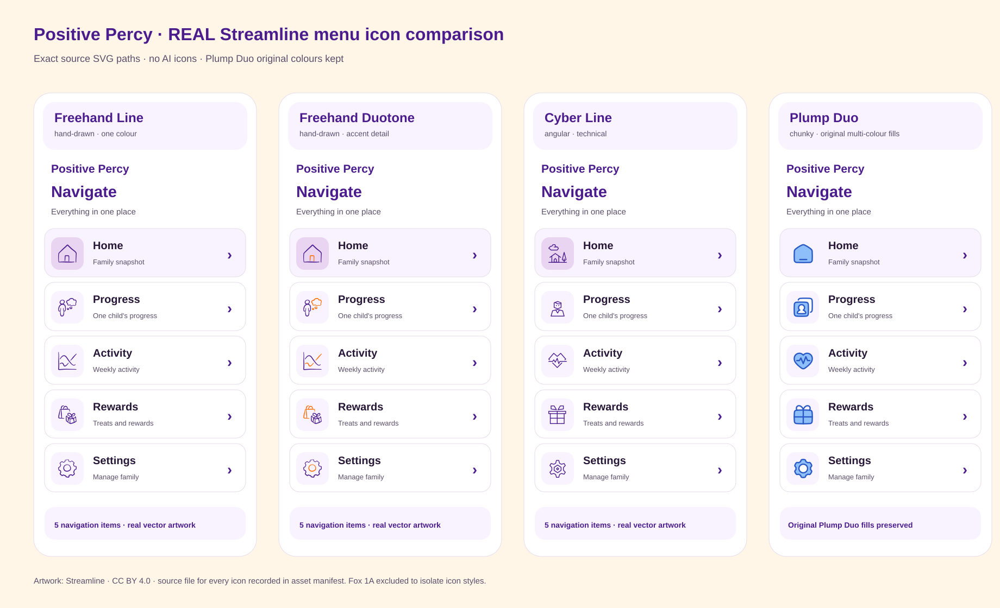
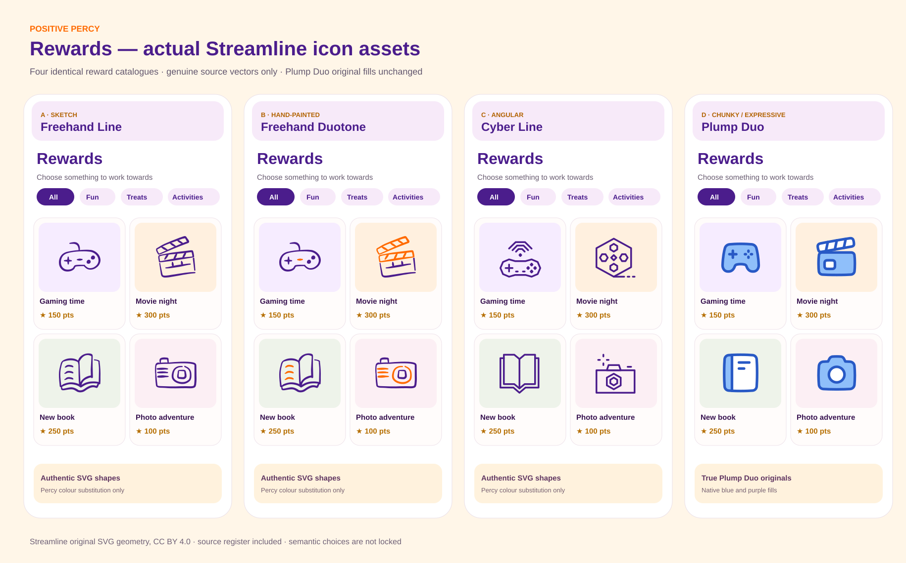
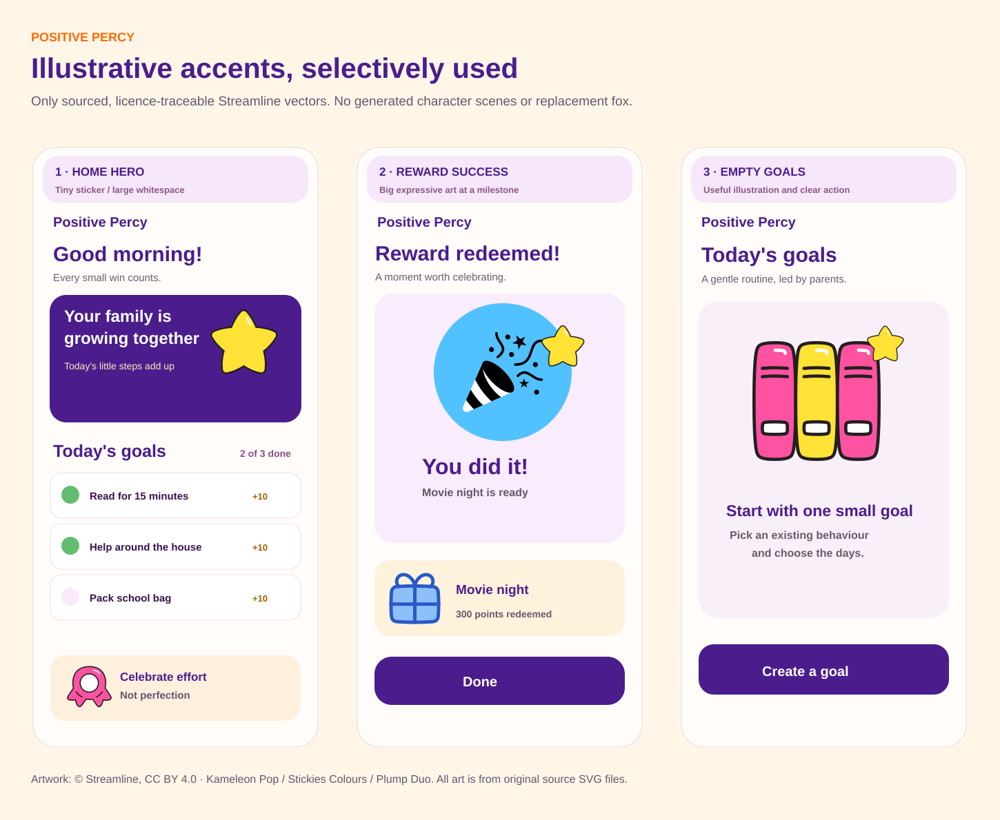
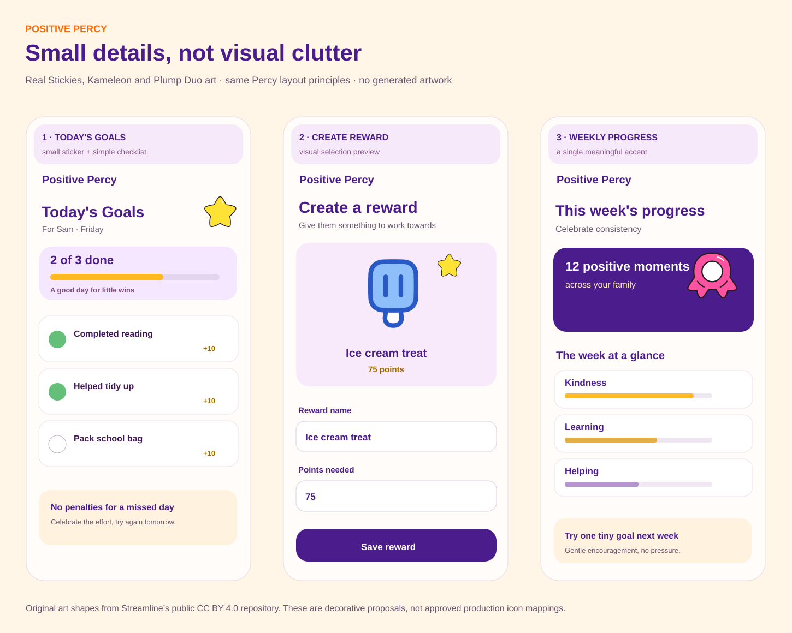

# Positive Percy — verified, ship-capable icon + decorative asset decision pack (v3)

> **Design review only — no production deployment, no AI-generated mockups.** All artwork embedded below is exact Streamline source-vector geometry fetched from the [official public repository](https://github.com/webalys-hq/streamline-vectors) and used inside code-authored screen layouts. No icon has been imagined, traced, or interpreted by an image generator. Any colour changes are explicitly noted. The user decides every final navigation/control icon.

## A. Navigation/menu: four real families

[Open the full-size menu board](shipready-v3-menu-real-4-families.svg)

Compare **Freehand Line**, **Freehand Duotone**, **Cyber Line** and **Plump Duo**. The last column embeds the **original, unchanged Plump Duo multicolour SVGs**. The other three columns recolour source fill/stroke values to Percy purple/orange without modifying path geometry. Labels are identical, but individual glyphs are *candidates only* and some are poor semantic matches; do not merge or treat any icon selection as approved.

## B. Rewards: four real families

[Open the full-size rewards board](shipready-v3-rewards-real-4-families.svg)

Same four reward concepts in all four libraries: **Gaming time, Movie night, New book, Photo adventure**. Plump Duo uses its authentic fills and original 48px design geometry, not a one-colour recolouring or an illustrated AI replacement.

## C. Illustration-sized spots: selectively placed source art

[Open illustrated-moments board](shipready-v3-selective-illustrative-moments.svg)

Three **potential placements**, not three new illustrations: a small Stickies star on Home, a larger Kameleon Pop party-popper and Plump gift at redemption, and a Stickies Books graphic in the empty Goals state. This uses **actual open-source illustrated vector/sticker assets** at larger sizes; it does **not** pretend to demonstrate Streamline's separately licensed Seoul, Bangalore or Manila illustration sets.

## D. Light decorative elements: restrained use of real assets

[Open decorative-elements board](shipready-v3-selective-ui-elements.svg)

Stickies-colour star/medal and Plump Duo ice-cream artwork appear in limited places. Decorative cards, borders and progress bars are ordinary SVG/CSS-style shapes the team can implement; **no graphic elements from an unlicensed library were invented**.

## Upstream sources and licensing

- [Staged, unchanged local SVGs (16 source assets)](../assets/streamline/)
- [Complete 16-asset registry](../assets/streamline/asset-registry.json) with `asset_id`, `library`, `family`, `variant`, `local_file_path`, `license_reference`, `semantic_name`, source commit, and status.
- [Earlier icon-by-icon catalogue register](REAL_STREAMLINE_ICON_ASSET_REGISTER.md); v3 takes precedence for visual comparison and Plump Duo original-fill handling.
- [Official upstream repository](https://github.com/webalys-hq/streamline-vectors), pinned at commit `52d750c9ce051e51cb181b7a78932120c48541d0`.
- [CC BY 4.0](https://creativecommons.org/licenses/by/4.0/) requires appropriate attribution and a license link; Streamline requires a site link. Follow [Streamline's free licence](https://help.streamlinehq.com/en/articles/5354376-streamline-free-license) and check the terms for **user-selectable reward icon pickers**, not only passive in-app artwork.

## Non-negotiable acceptance gates

1. **User chooses each icon.** These candidate glyphs are not final nav/behaviour/control assignments. Do not automatically swap the existing Phosphor registry for Streamline.
2. **No fake mascot.** The Fox 1A brand reference is approved, but this kit does not contain a verified final master file, so no replacement fox or stock animal was added. A proper production 1A asset must be supplied or acquired before a final brand-fidelity release.
3. **No substituted points currency.** The yellow Stickies star is a decorative candidate, **not** the dedicated approved Percy points star.
4. **Real-world typography check still needed.** This is vector layout source, not a screenshot from the React production build. It specifies Nunito/Poppins, but GitHub may render fallback fonts if the viewer lacks them. Final sign-off requires installed fonts and actual 390px / 834px / 1280px build screenshots.
5. **Icons must exist in the app.** Approved candidates should be imported from the staged original SVG files and registered by IDs. Preserve existing reward emoji values through backward-compatible semantic mappings.
6. **Parent controls remain unchanged.** The screens introduce no new child login, points economy, backdating or extra reward entitlement.
7. **Design hold remains.** PR #47 and dependent PRs #46/#45 are draft and are not to be merged/deployed on visual comparisons alone.

### Decision sequence

First decide whether a single icon family or mixed approach feels best at real sizes. Then **you choose** the actual symbols for each tab/control/behaviour. Finally decide which (if any) decorative sticker treatments add value, and approve a React preview with exact icons, fonts, logo, and responsive screenshots before implementation release.
