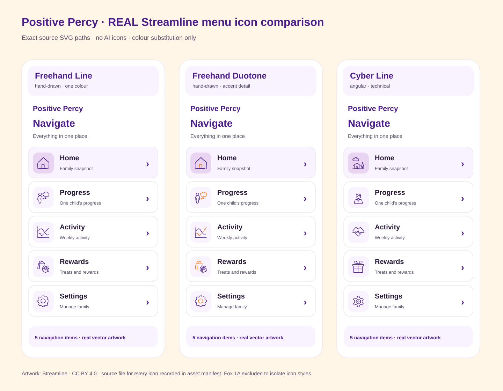
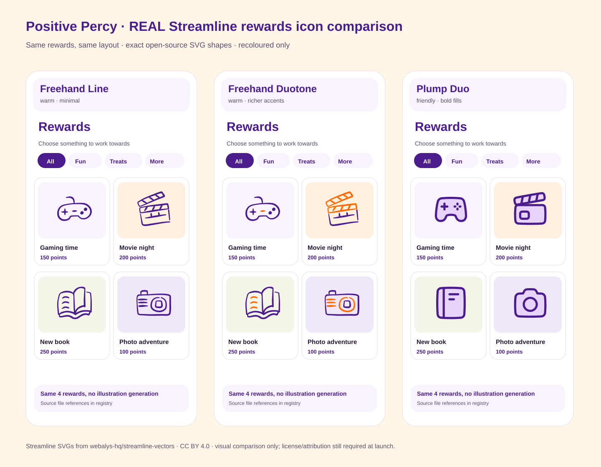

# Positive Percy — real Streamline icon comparison

**These mockups embed SVG paths from Streamline's own public repository, not AI-generated artwork.** The icon geometry is unchanged, with the approved Percy purple/orange palette applied to fill and stroke colours. Brand fox and points-star are deliberately omitted to isolate icon style.

## 1. Menu — Freehand Line vs Freehand Duotone vs Cyber Line

[Open menu artwork directly](real-streamline-menu-comparison.svg)

## 2. Rewards — Freehand Line vs Freehand Duotone vs Plump Duo

[Open rewards artwork directly](real-streamline-rewards-comparison.svg)

## Source verification and licensing

[See the asset-by-asset register for all 27 SVGs](REAL_STREAMLINE_ICON_ASSET_REGISTER.md), with exact source URLs, families, license and colour substitutions. The original open-source repository is [webalys-hq/streamline-vectors](https://github.com/webalys-hq/streamline-vectors).

- **Caveat:** This comparison uses selected icons actually present in the **free open-source** subsets. The available Freehand icon subset has semantic gaps for generic profile and gift icons; do not approve those specific shapes as final navigation mappings without confirming better icons are available and licensed.
- **Licensing:** CC BY 4.0 as stated in Streamline's public repository; production attribution and use in a selectable rewards picker must be checked before launch.
- **Release status:** Design only, no production code changes or merge. Previous AI-generated comparison boards are rejected and superseded by these embedded-source visuals.
