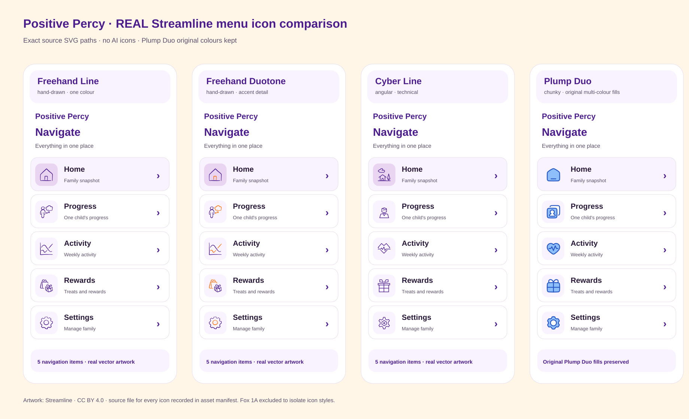
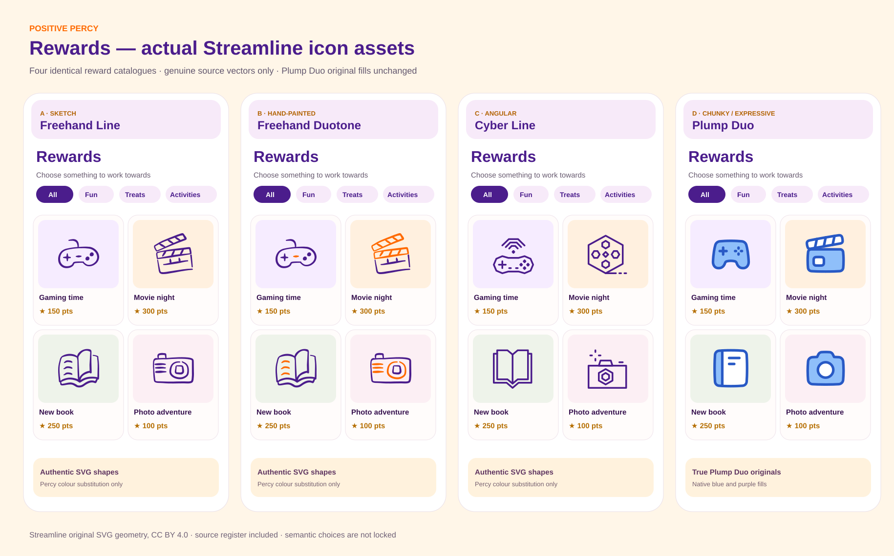
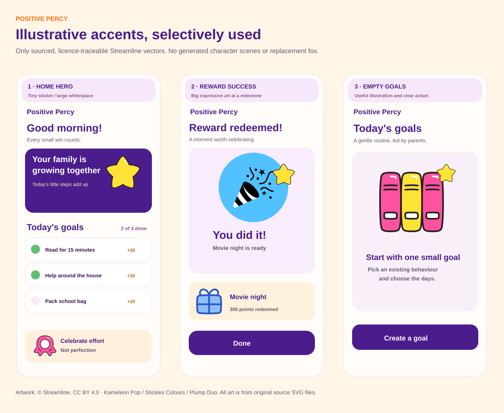
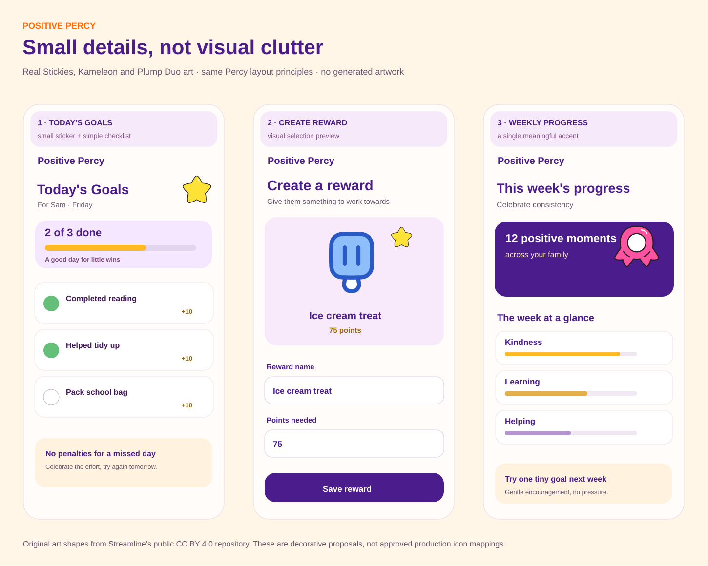

# Positive Percy — Stage 1 visual asset selection

**Decision pack · 13 November 2026 · Partial owner mappings recorded (38 contexts + 12 picker category lists)**

> **Everything pictured is exact source artwork, now bundled locally so all icon previews remain visible without external hotlinks.** This review uses official MIT Phosphor SVGs and CC BY 4.0 files from Streamline's public open-source repository. No image generation, AI icon interpretation, copied premium previews or fabricated fox artwork. Preview boards are code-authored layouts with embedded source SVGs, **not screenshots of a running app**. Until you approve each asset, **nothing here changes Percy's production UI**.

### Continue with remaining visual decisions

[**Open illustrations and decorative elements selector**](https://percy-stage1-design-selector-production.up.railway.app/?section=visual). All three previous icon rejections have now been resolved by explicit owner selections.

### Choose where to start

| Stage | Preview of actual source vectors | Review and choose |
|---|---|---|
| **1 · Navigation + controls** |     | [Open 15-function selection board](01_NAV_CONTROLS.md) |
| **2 · Behaviours + Today's Goals** |     | [Open 11-context selection board](02_BEHAVIOURS_GOALS.md) |
| **3 · Reward artwork** |    | [Open 12-reward icon selection board](03_REWARDS.md) |
| **4 · Illustrations + elements** |   | [Open 6 placements + 4 decorative roles](04_ILLUSTRATIONS_ELEMENTS.md) |
| **5 · Parent reward picker** |     | [Open full 12-category picker gallery](05_PARENT_PICKER.md) |

**[Owner selections and remaining approval worksheet](06_APPROVAL_WORKSHEET.md)** · **[Canonical owner approval register](APPROVAL_REGISTER.json)** · [Source manifest (CSV)](ASSET_REGISTRY.csv) · [Manifest with all metadata (JSON)](ASSET_REGISTRY.json)

## Compare the families at Percy screen scale

These four boards use the **actual SVG paths**, not generated approximations. Their particular displayed glyphs are *only for judging family aesthetics*, not selections for any tab.

[**Menu — Freehand Line, Freehand Duotone, Cyber and Plump Duo**](../previews/shipready-v3-menu-real-4-families.svg)

[**Rewards — four icon-family treatments including original-colour Plump Duo**](../previews/shipready-v3-rewards-real-4-families.svg)

[**Selective illustration-sized accents**](../previews/shipready-v3-selective-illustrative-moments.svg)

[**Light decorative treatments**](../previews/shipready-v3-selective-ui-elements.svg)

## Scope at a glance

| Category | What is ready for your review | Approval status |
|---|---|---|
| Navigation | 5 functions × 3 verified Phosphor candidates + real Streamline style board | **See approval register** |
| Controls | 10 actions × 3 verified candidates | **Review owner decision register** |
| Behaviours/Goals | 11 contexts × 3 candidate icons + constrained parent-focused Goals layout | **Unselected** |
| Rewards | 12 examples × 2 original Plump Duo alternatives + MIT Phosphor fallback | **Unselected** |
| Illustrations | 6 selective placements with 3 existing-source SVG options and a **None** option | **Unselected** |
| Elements | 4 decorative roles with 2 source candidates and **None** | **Unselected** |
| Parent picker | 12 categories, **144 placements / 115 distinct Phosphor Duotone SVGs**, all MIT | **Unselected** |
| Traceability | **221 verified asset/weight entries** in registry; **34 original Streamline SVG files** copied into review branch | Ready for technical review |

## Guardrails before the final design lock

1. **You decide** each icon and weight. A table position never means "selected". Respond with an exact filename such as `phosphor:house-simple:duotone`, `streamline:plump:duo:food-drink:ice-cream-2`, or "none, show more".
2. **Brand remains fixed:** Fox 1A, dedicated Percy points star, purple `#4B1D8C`, orange `#FF6A00`, cream `#FFF6E8`, Nunito/Poppins. This stage is not permission to replace the fox or points currency. The final production master for Fox 1A is still needed; none is invented in this pack.
3. **Parent-only Goals:** at most three goals shown in compact Home, points inherited from existing behaviour category, family-local date, actual idempotent ledger award, Undo, no punishment for missed days.
4. **Reward picker ships safely:** MIT Phosphor only unless and until we have explicit, written Streamline clearance for a parent-selectable catalogue. Curated Plump Duo visuals are separate from that picker question.
5. **Exact implementation only:** Selected source file/variant must be rendered unchanged or with explicitly approved colour treatment. The next approval gate is the **running React preview**, real fonts, final brand assets and captures at **390px, 834px and 1280px**.
6. **No release action:** PR #47 and this Stage 1 branch remain design-only. No merges, deployment, or replacement of current navigation/controls.

## Licence and source provenance

The source is pinned to exact commits so nothing changes after review:

- [Official Phosphor Icons core](https://github.com/phosphor-icons/core/tree/2b75f3ad12b420c9504ef05df8d2564a28f8500e), **MIT**.
- [Streamline's official open-source vectors](https://github.com/webalys-hq/streamline-vectors/tree/52d750c9ce051e51cb181b7a78932120c48541d0), **CC BY 4.0**, source files copied unchanged into `design/assets/streamline/`; attribution and permissible picker redistribution require review.
- [Streamline licence notes](https://help.streamlinehq.com/en/articles/5354376-streamline-free-license). Not all "free" graphic libraries have the same terms.
- [Original Percy fidelity & Goals brief](https://github.com/soulglo82/positive_percy) was used as the specification for the board's constraints; this page is not a replacement for it.

**First review action:** open **Navigation + controls**, then **Behaviours + Goals**. You can select nothing until you've seen the full comparison.
